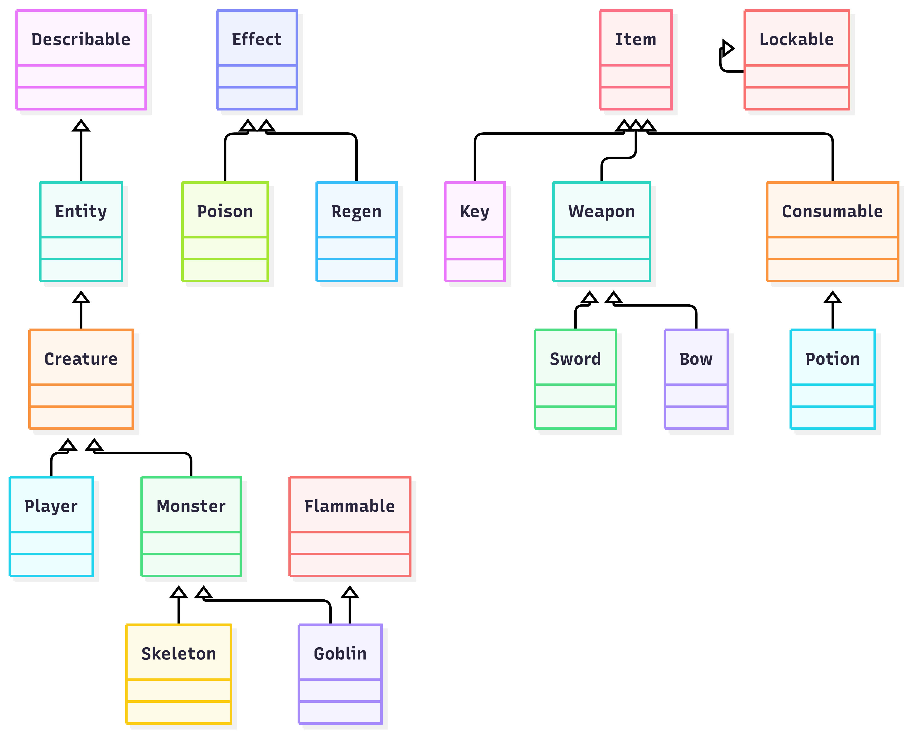

Joshua Samuel     
CS 361

# Challenge 4.3: What's a Class Hierarchy?

Note: Lockable is meant to be alone and unconnected but I had trouble getting by itself, so it points to itself.
```
classDiagram
    Describable <|-- Entity
    Entity <|-- Creature
    Creature <|-- Player
    Creature <|-- Monster
    Monster <|-- Goblin
    Flammable <|-- Goblin
    Monster <|-- Skeleton
    Effect <|-- Poison
    Effect <|--Regen
    Item <|-- Key
    Item <|-- Weapon
    Item <|-- Consumable
    Consumable <|-- Potion
    Weapon <|-- Sword
    Weapon <|-- Bow
    Lockable <|-- Lockable
```


