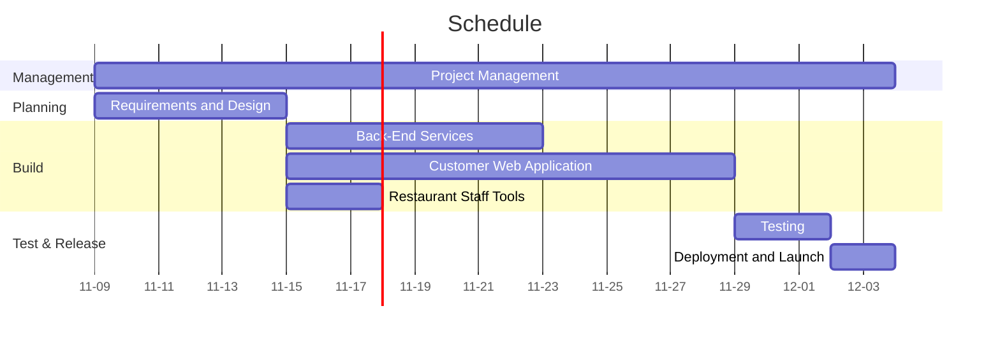

Joshua Samuel     
CS 361

# Challenge 6.3: Gantt Chart

1. Quick and dirty total estimate: 40 days (if tasks done sequentially)

2. 
    | Tasks | Days |
    |---|---|
    | Project Management (10%) | 4 |
    | Requirements and Design (15%) | 6 |
    | Customer Web Application (35%) | 14 |
    | Back-End Services (20%) | 8 |
    | Restaurant Staff Tools (7%) | 3 |
    | Testing (8%) | 3 |
    | Deployment and Launch (5%) | 2 |
    | Online-Pizza Ordering System (100%) | 40 |

3. 
    * Project managment should happen at every step of the project and so **will be parallel with everything that follows**.
    * Requirements and Design will be the first task on the schedule and will be by itself.
    * Customer Web Application, Back-End Services, and Restaurant Staff tools will be parallel together.
    * Testing will be alone.
    * Deployment and Launch will be alone.

4. Project managment is set to 25d in the code since the parallel tasks bring down the time the project will take.
