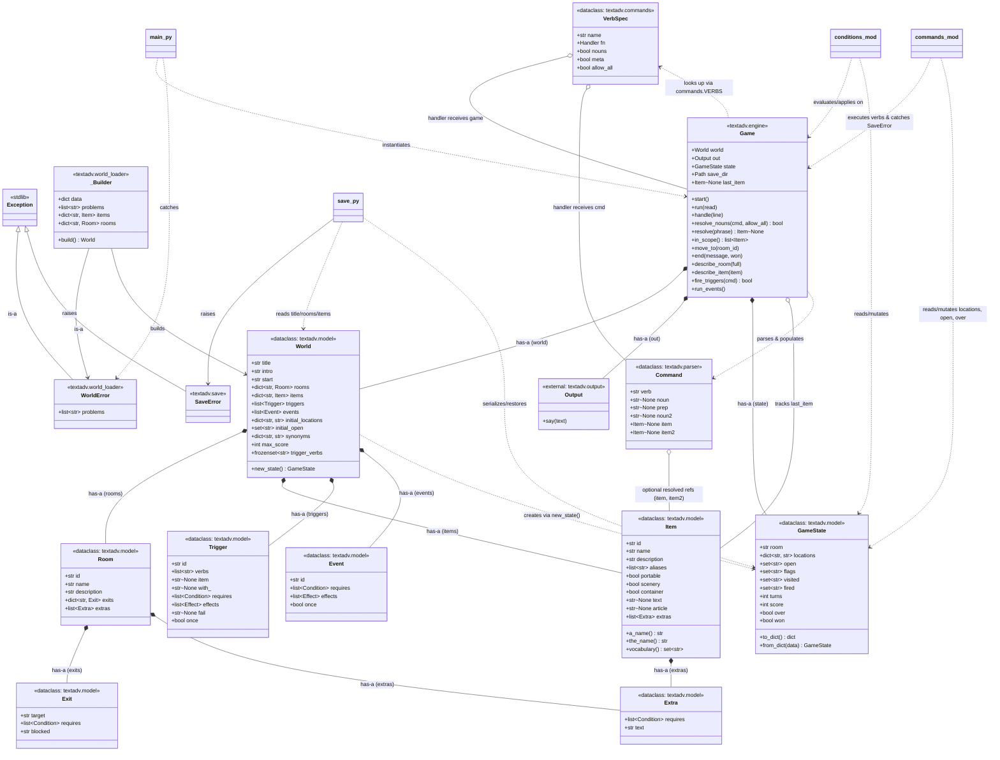
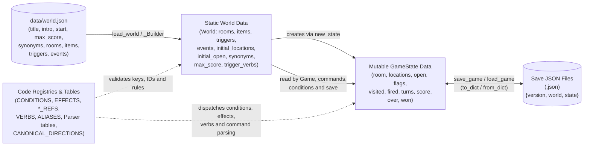

Joshua Samuel

# Challenge 9.1

## Import dependencies 
### Imports inside of main.py
* import argparse
* import sys
* from pathlib import Path
* import readline
* from textadv.engine import Game
* from textadv.world_loader import WorldError, load_world

### Imports inside of world_loader.py
* from __future__ import annotations
* import json
* from pathlib import Path
* from . import conditions
* from .model import (
    INVENTORY, Event, Exit, Extra, Item, Room, Trigger, World, in_loc, room_loc,
)
* from .parser import CANONICAL_DIRECTIONS

### Imports inside of save.py
* from __future__ import annotations
* import json
* import re
* from pathlib import Path
* from .model import GameState, World

### Imports from parser.py
* from __future__ import annotations
* import re
* from dataclasses import dataclass
* from typing import TYPE_CHECKING
* from .model import Item

### Imports from output.py
* from __future__ import annotations
* import shutil
* import textwrap
* from collections.abc import Callable

### Imports from model.py
* from __future__ import annotations
* from dataclasses import asdict, dataclass, field, fields

### Imports from engine.py
* from __future__ import annotations
* from collections.abc import Callable
* from pathlib import Path
* from . import commands
* from .conditions import apply_all, check_all
* from .model import INVENTORY, Extra, GameState, Item, World, in_loc,  room_loc
* from .output import Output, join_list
* from .parser import Command, parse

### Imports from conditions.py
* from __future__ import annotations
* from typing import TYPE_CHECKING
* from .model import INVENTORY, Condition, Effect, room_loc
* from .engine import Game

### Imports from commands.py
* from __future__ import annotations
* from collections.abc import Callable
* from dataclasses import dataclass
* from typing import TYPE_CHECKING
* from .conditions import check_all
* from .model import INVENTORY, Item, in_loc, room_loc
* from .output import join_list
* from .parser import CANONICAL_DIRECTIONS, Command
* from .save import SaveError, load_game, save_game, save_path
* from .engine import Game

## Class dependencies
### Classesinside of main.py
* constant DEFAULT_WORLD (has-a) Path
* main (has-a) ArgumentParser and Path and WorldError and Game
* 
### Classes inside of world_loader.py
* class WorldError (is-a) Exception
* func load_world (has-a) Path
    raises WorldError
    calls on build_world
* func build_world (has-a) _Builder
* class _Builder (has-a) Item and a Room
* func build return class World
* make_extras makes a class Extra
* make_item makes a claaa Item
* make_room makes a class Room with a class Exit
* make_trigger makes a class Trigger
* make_event makes a class Event

### Classes inside of save.py
* SaveError (is-a) Exception

## Data dependencies
### Data inside of main.py
* __file__
* description
* help
* world
### Data inside of world_loader.py
* data = json.load(f)
* self.problem (list) of msg
    msg is a string
* self.items (list) of Item
* self.rooms (list) of Room

# Mermaid diagram 
Yes, I used AI for this part. Yes, it reminds me of spaghetti. 

### Imports

```mermaid
flowchart TD
    main["main.py"]
    pkg_init["textadv/__init__.py"]
    world_loader["textadv.world_loader"]
    save["textadv.save"]
    parser["textadv.parser"]
    model["textadv.model"]
    engine["textadv.engine"]
    conditions["textadv.conditions"]
    commands["textadv.commands"]
    output_ext["textadv.output (external)"]

    %% Package anchor
    pkg_init -.->|package namespace| world_loader
    pkg_init -.->|package namespace| save
    pkg_init -.->|package namespace| parser
    pkg_init -.->|package namespace| model
    pkg_init -.->|package namespace| engine
    pkg_init -.->|package namespace| conditions
    pkg_init -.->|package namespace| commands

    %% Standard Library
    main --> argparse["argparse (stdlib)"]
    main --> sys["sys (stdlib)"]
    main --> pathlib["pathlib.Path (stdlib)"]
    main -.->|optional| readline["readline (stdlib)"]
    world_loader --> json["json (stdlib)"]
    world_loader --> pathlib
    save --> json
    save --> re["re (stdlib)"]
    save --> pathlib
    parser --> re
    parser --> dataclasses_p["dataclasses.dataclass (stdlib)"]
    parser --> typing_p["typing.TYPE_CHECKING (stdlib)"]
    model --> dataclasses_m["dataclasses (asdict, dataclass,\nfield, fields) (stdlib)"]
    engine --> abc_e["collections.abc.Callable (stdlib)"]
    engine --> pathlib
    conditions --> typing_c["typing.TYPE_CHECKING (stdlib)"]
    commands --> abc_c["collections.abc.Callable (stdlib)"]
    commands --> dataclasses_c["dataclasses.dataclass (stdlib)"]
    commands --> typing_cmd["typing.TYPE_CHECKING (stdlib)"]

    %% Internal Modules
    main --> engine
    main --> world_loader
    world_loader --> conditions
    world_loader --> model
    world_loader --> parser
    save --> model
    parser -.->|TYPE_CHECKING only| model
    engine --> commands
    engine --> conditions
    engine --> model
    engine --> output_ext
    engine --> parser
    conditions --> model
    conditions -.->|TYPE_CHECKING only| engine
    commands --> conditions
    commands --> model
    commands --> output_ext
    commands --> parser
    commands --> save
    commands -.->|TYPE_CHECKING only| engine
```

### Classes

### Data
