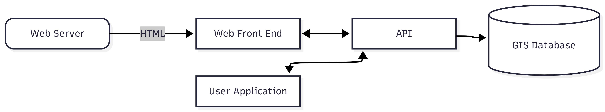
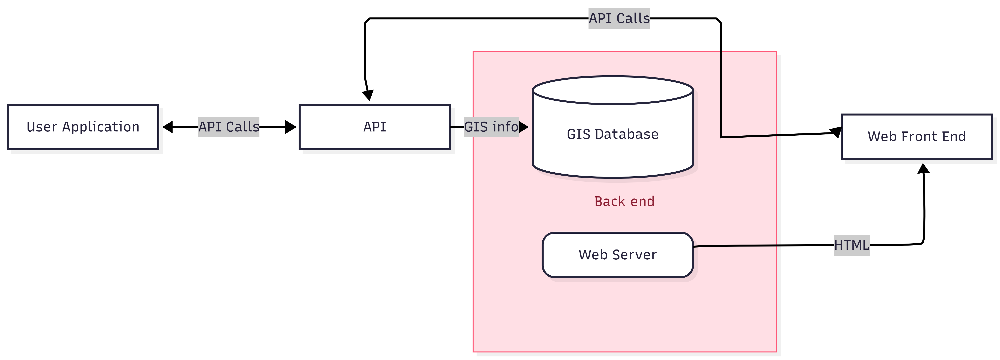

Joshua Samuel     
CS 361

# Challenge 4.1: Mermaid Diagram

mermaid code for part 1:

```
---
config:
  layout: fixed
---
flowchart TB
    A("Web Server") -- HTML --> B["Web Front End"]
    B <--> C["API"]
    C --> E["GIS Database"]
    C <--> D["User Application"]

    E@{ shape: cyl}
```



mermaid code for part 2:

```
---
config:
  layout: fixed
---
flowchart TB
    n1["Back end"]
    A("Web Server") -- HTML --> B["Web Front End"]
    B L_B_C_0@<-- API Calls --> C["API"]
    C -- GIS info --> E["GIS Database"]
    C <-- API Calls --> D["User Application"]

    n1@{ shape: rect}
    E@{ shape: cyl}
     n1:::Rose
    classDef Rose stroke-width:1px, stroke-dasharray:none, stroke:#FF5978, fill:#FFDFE5, color:#8E2236

    L_B_C_0@{ curve: linear }
```


