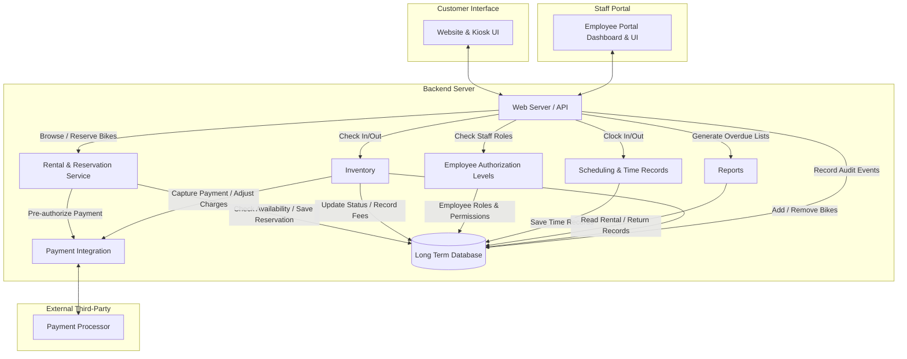

# Section 1: Overview

The software system requested by Bend Bike Shop enables customers to rent and reserve bikes for a requested period through the online website or in-store kiosk. Customers can browse inventory, filter bikes by type, view availability, and reserve bikes with or without an account. The system supports reservations up to six months in advance and rental periods of up to seven days.

Employees use the employee portal to verify reservations, check bikes out and in, record damage and maintenance notes, process payments, and manage rental transactions. Store managers have additional permissions to manage employees and inventory, approve restricted operations, and generate operational reports.

The system handles the complete rental lifecycle from reservation and payment pre-authorization through physical checkout, return, final payment processing, and inventory status updates. Payment card data is handled by an external payment processor rather than stored in the core backend database.

# Section 2: Actors

* **Customer:** Uses the website or in-store kiosk to browse and filter inventory, check bike availability, and place reservations. Customers provide identification details, contact information, and payment details for pre-authorization. They may create an account or reserve as a guest. Kiosk customers can swipe their payment cards.
* **Payment Processor (external):** Securely pre-authorizes funds, captures payments, processes card transactions and authorized adjustments, and manages payment card data. It returns transaction outcomes to the backend for recording.
* **Store Staff:** Uses the employee portal to look up reservations and customer records, check bikes in and out, record damage and maintenance notes, process rental returns, and handle payment-related tasks permitted by their role. Staff can clock in and out, with time records linked to schedules.
* **Store Manager:** Has elevated permissions to manage employee accounts, add or remove bikes, approve restricted actions, authorize credits, and generate and print reports. Manager approvals are required for designated operations, including restricted inventory management and report printing.

# Section 3: Goals/Non-Goals

## Goals

* **Reservation and Rental Lifecycle:** Customers can browse inventory, filter bikes by type, view availability, and reserve bikes up to six months in advance. Staff verify reservations, physically issue bikes, and process returns through the employee portal.
* **Inventory Management:** Bikes have recorded statuses reflecting their availability, rental, and maintenance state. Managers can add or remove bikes, while staff can check bikes in and out and place bikes under maintenance.
* **Authorization Controls:** Employee roles determine which operations are permitted. Managers can manage employee accounts and approve designated restricted actions, including report printing, inventory changes, and credit adjustments.
* **Scheduling and Time Records:** Staff can clock in and out, with recorded work times linked to schedules.
* **Reports:** Managers can generate and manually print overdue-bike reports for a specified date range.
* **Payment Processing:** The system supports payment pre-authorization, fund capture, payment adjustments, guest reservations with secure payment association, and recording transaction outcomes.
* **Reservation Integrity:** The backend prevents overlapping reservations for the same bike through an atomic reservation transaction or locking mechanism.
* **Operational Performance:** The system supports approximately 200 concurrent users and meets the specified response-time targets.

## Non-Goals

* Automated discounts or dynamic pricing for available bikes.
* Outright bike sales or automated charges for unreturned bikes. These require employee or manager intervention.
* Automated rental extensions. Extensions must be handled by store staff.
* Automated physical bike handoffs or checkouts.
* Advertising, which is outside the scope of this system.

# Section 4: Constraints

1. Customers must be able to swipe payment cards at the kiosk rather than entering all card information manually.
2. Customers must be able to make reservations as guests; creating an account is optional.
3. Rentals have a maximum duration of seven days. Rental durations are issued in four-hour intervals, and one day's rental fee is equivalent to twelve hours. Extensions must be handled by store staff.
4. Reservations must be available up to six months in advance.
5. Customers must be able to filter bikes on the website.
6. A bike cannot be reserved for overlapping rental periods. Availability validation and reservation creation must be protected by an atomic transaction, database constraint, or locking mechanism.
7. Payment card data must be managed by the external payment processor and must not be stored in the core backend database.
8. Manager authorization is required for operations designated as manager-only. A manager is assumed to be present when manager authorization is needed.
9. Reports are manually printed and must support a requested date range.
10. The system must support the website, customer kiosk, and employee portal through the backend server.

# Section 5: Assumptions

1. The external payment processor API is available 99% of the time.
2. The website must support an average of 200 concurrent users.
3. Reservation creation requires an atomic operation, transaction, or locking mechanism to prevent double booking.
4. A manager will be present for all operations requiring manager authorization.
5. Reports are generated on demand and printed manually for a specified date range.
6. Guest reservations must retain a secure association with their payment transaction and reservation record without requiring a customer account.
7. Payment processing outcomes must be recorded so that failed, pending, and successful transactions can be distinguished.
8. Bike availability is determined from its inventory status and existing reservations or rentals for the requested period.
9. The system records reservation dates, scheduled return times, actual return times, fees, payment outcomes, and relevant staff actions to support rental operations and overdue reporting.
10. Rental duration and fee calculations use the shop's defined four-hour intervals and twelve-hour daily fee basis.
11. Manager approvals and other restricted actions are attributable to the employee who performed or approved them.

# Section 6: Non-Functional Requirements

1. The payment processor must respond within 1.5 seconds for 95% of requests.
2. Website reservation requests must be processed within six seconds.
3. Customer and bike history lookups must load within five seconds.
4. Staff must be logged out of the employee portal after one minute of inactivity.
5. The customer kiosk must reset to its home screen after one minute of inactivity.
6. The system must support an average of 200 concurrent website users.
7. Reservation processing must maintain data consistency under concurrent requests and must not allow overlapping bookings for the same bike.
8. Communication with the payment processor must use a secure API integration. Payment card details must remain outside the core backend database.
9. Employee permissions must be validated on the backend for restricted operations rather than relying solely on interface controls.
10. Payment outcomes, manager approvals, financial adjustments, and relevant inventory changes must be recorded for operational traceability.
11. A failed payment request must not result in a reservation being represented as successfully paid or pre-authorized. The reservation and payment status must reflect the actual processor outcome.
12. Customer-facing reservation confirmation must clearly communicate the reservation status. Successful reservations must trigger the specified confirmation message and email notification.

# Section 7: Component Diagram and Description

| Component | Responsibility |
|---|---|
| **Website & Kiosk UI** | Provides customer-facing browsing, bike-type filtering, availability selection, reservation checkout, contact details, payment interaction, and confirmation. Supports guest reservations and account-based reservations. The kiosk supports card swiping and resets after one minute of inactivity. |
| **Employee Portal Dashboard & UI** | Provides staff access to reservation lookup, customer and bike history, bike checkout and check-in, payment workflows, maintenance notes, scheduling, and permitted inventory operations. The portal enforces the one-minute inactivity logout requirement. |
| **Web Server / API** | Serves as the entry point for customer and employee interfaces. Validates requests, routes operations to backend services, enforces authentication and authorization, and returns operation results. |
| **Rental & Reservation Service** | Checks availability, applies rental-duration and advance-booking constraints, creates reservations, retrieves reservation details, and coordinates payment pre-authorization. Reservation creation must be atomic to prevent overlapping bookings. |
| **Inventory** | Maintains bike records and statuses, supports checkout and check-in, records actual return times, calculates applicable late fees, stores damage and maintenance notes, and supports authorized bike additions and removals. It coordinates final payment actions with the payment integration component. |
| **Employee Authorization Levels** | Authenticates employee roles and determines which operations each employee may perform. Enforces manager approval for restricted operations, including designated financial adjustments, inventory changes, employee administration, and report printing. |
| **Reports** | Retrieves rental and return records, identifies overdue bikes for a requested date range, and produces reports for manual printing. Report generation and printing permissions are subject to manager authorization. |
| **Scheduling & Time Records** | Records employee clock-in and clock-out events and associates time records with schedules. |
| **Payment Integration** | Communicates with the external payment processor for pre-authorization, payment capture, and permitted financial adjustments. Associates processor transaction references with reservations and rental transactions, records outcomes, and avoids storing card data in the core database. |
| **Long Term Database** | Stores customer accounts and contact details, bike inventory, reservations, rental and return records, payment transaction references and statuses, employee accounts and roles, time records, maintenance notes, manager approvals, and audit events. It does not store payment card data. |
| **Payment Processor** | Securely manages card data and performs payment pre-authorization, capture, and authorized transaction adjustments. Returns transaction status and references to the backend. |

## 7.1 Core Data Records

The database maintains the following logical records:

* **Customer:** Customer identifier, contact details, identification details, and optional account credentials.
* **Bike:** Bike identifier, type, size, description, image reference, inventory status, and maintenance information.
* **Reservation:** Reservation identifier, customer or guest association, selected bike, rental start and end times, reservation status, and payment status.
* **Rental:** Rental identifier, reservation association, bike, checkout time, expected return time, actual return time, staff actions, and applicable fees.
* **Payment Transaction:** Transaction identifier, associated reservation or rental, processor reference, transaction type, amount, status, and timestamps. No payment card number or security code is stored.
* **Employee:** Employee identifier, login credentials in securely hashed form, role, and account status.
* **Time Record:** Employee identifier, schedule association, clock-in time, and clock-out time.
* **Maintenance Record:** Bike identifier, technician notes, damage description, maintenance status, and associated dates.
* **Audit Event:** Acting employee, action performed, timestamp, affected record, approval details where applicable, and the reason for financial overrides or other required approvals.

## 7.2 Reservation and Payment Flow

1. The customer selects the rental dates and filters available bikes by type.
2. The Rental & Reservation Service retrieves bikes eligible for the requested period, excluding bikes that are unavailable, under maintenance, or already committed to overlapping reservations or rentals.
3. The customer selects a bike and provides the required contact, identification, and payment information. Account creation remains optional.
4. The backend validates the rental duration, advance-booking limit, and current bike availability.
5. The Payment Integration component requests payment pre-authorization from the external processor.
6. After the required payment outcome is confirmed, the backend atomically commits the reservation and its payment association. Concurrent requests must not create overlapping reservations for the same bike.
7. The interface displays the resulting reservation status. Successful reservations display a confirmation and notify the customer that an email confirmation will also be sent.
8. If payment or reservation creation fails, the backend records the failure and does not report the reservation as successfully confirmed. Any authorization that was obtained but cannot be used must be handled through the payment processor's supported cancellation or release operation.

## 7.3 Checkout, Return, and Final Payment Flow

1. Staff locate the reservation or customer record through the employee portal and verify the reservation before issuing the bike.
2. Staff record the physical checkout, expected return time, and relevant rental details.
3. At return, staff retrieve the rental record and record the actual return time, bike condition, and technician notes if damage is reported.
4. The system calculates applicable late fees using the shop's rental-duration and fee rules. Staff may record additional damage or replacement-related charges as permitted.
5. The Payment Integration component captures the appropriate amount or processes an authorized adjustment through the payment processor. The transaction outcome is saved.
6. Staff complete the return and generate or send the receipt as appropriate. The bike's inventory status is updated to available, maintenance, or another applicable status.
7. When a bike is reported lost or is no longer rentable, staff or management handle the required transaction manually and an authorized manager removes the bike from inventory.

## 7.4 Authorization and Audit Flow

1. Employees authenticate through the employee portal.
2. The backend verifies the employee's role before executing restricted actions.
3. Normal staff cannot execute manager-only operations, even if a restricted control is visible or invoked directly.
4. For manager-approved actions, the manager authenticates or provides the required authorization before the operation proceeds.
5. Financial overrides must record the reason, amount, approving manager, and associated transaction.
6. Inventory changes, employee account changes, report-generation or printing approvals, and other designated restricted actions are recorded in the audit trail.

## 7.5 Overdue Reporting Flow

1. An authorized manager opens the reports screen and selects the overdue-bike report.
2. The manager specifies the requested date range.
3. The Reports component retrieves rentals whose expected return times and recorded return statuses meet the overdue-report criteria.
4. The report displays the associated bike, customer or rental reference, expected return time, and current return status.
5. The manager confirms printing, and the system produces a report suitable for manual printing.
6. Staff use the report to contact customers and resolve overdue rentals. Any resulting check-in, fee adjustment, payment, or inventory change is recorded through the corresponding workflow.

## 7.6 Scheduling and Inactivity Handling

* Staff clock-in and clock-out actions create time records linked to the employee and applicable schedule.
* The employee portal tracks inactivity and terminates the staff session after one minute without activity.
* The kiosk resets to its home screen after one minute without activity. The reset clears the customer-facing session state so the next customer cannot access the previous customer's reservation details.
* Payment operations are executed through the backend integration, and their recorded statuses remain associated with the relevant reservation or rental transaction.

## 7.7 Performance Targets

| Operation | Requirement |
|---|---|
| Payment processor response | Within 1.5 seconds for 95% of requests |
| Website reservation processing | Within 6 seconds |
| Customer or bike history lookup | Within 5 seconds |
| Staff portal inactivity timeout | 1 minute |
| Customer kiosk inactivity reset | 1 minute |
| Average concurrent website users | 200 |
| Payment processor availability assumption | 99% |
| Reservation advance-booking window | Up to 6 months |
| Maximum standard rental duration | 7 days |

The reservation service must maintain consistency when multiple customers attempt to reserve the same bike concurrently. Payment calls and database operations must be coordinated so that the system does not confirm an unsuccessful reservation or incorrectly represent an incomplete payment transaction as completed.
