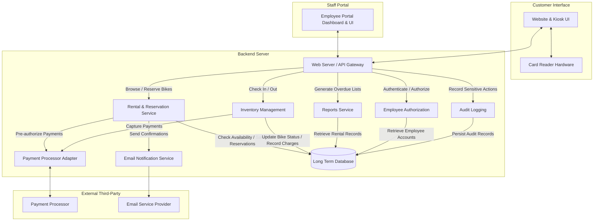
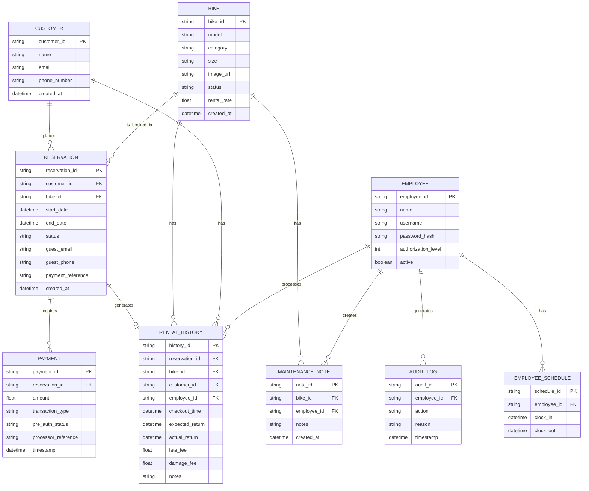

# Bend Bike Shop – Expanded Design Document

# Section 1: Overview
The software system requested by the Bend Bike Shop will enable customers to rent and reserve bikes for a requested period of time through an online website or in-store kiosk. Employees will be able to confirm rentals, process returns, and manage the details of the store's inventory. The system handles the complete rental cycle from reservation to return.

The system will consist of three primary interfaces:
- **Customer Website:** Allows customers to browse bikes, filter inventory, check availability, create accounts, and make reservations.
- **Customer Kiosk:** Provides the same reservation functionality as the website, with additional support for card-swiping hardware and guest reservations.
- **Employee Portal:** Allows employees and managers to manage reservations, check bikes in and out, process payments, maintain inventory, and generate reports based on their authorization level.

The backend will coordinate these interfaces with the database and external payment processor. All reservations must be validated against existing bookings to prevent overlapping rentals of the same bike.

# Section 2: Actors

* **Customer:** Use the online website or store kiosk to browse and filter the store's bike inventory and reserve bikes for available dates. They provide identification details, contact information, and a payment card for pre-authorization. Customers may create an account or proceed as guests. Account holders can view their reservation history and manage their contact information. Guest reservations are associated with the contact and payment references provided during checkout.
* **Payment Processor (external):** An external third-party service that securely pre-authorizes funds, processes credit/debit card transactions, and manages card data outside the core backend database to maintain compliance. The processor returns transaction identifiers and authorization results to the backend.
* **Store Staff:** Use the employee portal to check in/out bikes, manage inventory statuses, check reservations, process customer payments, record maintenance notes, and update customer rental records. Staff permissions do not include manager-only actions.
* **Store Manager:** A higher level of authorization that is needed to perform certain operations including managing employees, printing reports, adding/removing inventory, and general manager approvals. Managers can also approve financial adjustments and other restricted operations. Manager actions must be recorded in an audit log.
* **System Administrator:** Responsible for maintaining the application infrastructure, database connectivity, and system availability. Administrators receive critical system alerts but do not automatically receive manager permissions for store operations.

# Section 3: Goals/Non-Goals

## Goals:
* **Reservation & Rental Lifecycle:** Customers can browse inventory, view availability, and reserve bikes up to six months in advance. Reservations can be made through either the website or kiosk, with or without a customer account. Staff can verify reservations, check out bikes, and check in rentals. Reservations must support a maximum rental period of seven consecutive days.
* **Inventory Management:** Store managers can add or remove bikes, while staff can check in/out bikes and place them under maintenance. Each bike must have a unique identifier and a current operational status. Inventory changes must persist in the database.
* **Authorization Controls:** Store managers can manage employee accounts and grant manager approvals for certain actions (printing reports, inventory management, and credit accounts). The backend must enforce permissions regardless of which interface sends the request.
* **Schedules:** Staff can clock in/out, with time records linked to schedules. Each clock event must be associated with an authenticated employee and timestamp.
* **Reports:** Managers can manually generate and print overdue bike reports by a specified date range. Reports must include relevant bike, customer, reservation, and expected return information.
* **Payment Processing:** The system supports secure pre-authorizations, captures funds through an integrated payment processor, handles guest reservations via secure payment association, and logs transaction outcomes. Payment information must remain outside the core backend database.
* **Reservation Notifications:** Customers receive reservation confirmation through the website or kiosk and an email confirming their reservation. The reservation record must contain the contact information required for notification.
* **Rental History:** Customer and bike rental histories must be maintained to support reservation lookup, customer service, and inventory management.

## Non-Goals:
The following are beyond the scope of the system and are not required for the solution.
* Automated discounts or dynamic pricing for available bikes.
* No outright bike sales or automated charges of unreturned bikes. This will need an employee or manager.
* Rental extensions must also go through employees.
* No automated handoffs or checkouts of bikes.
* Don't worry about advertisements, that is for another team to worry about.

# Section 4: Constraints

1. Customers must be able to swipe their cards, so they don't need to enter their information manually at the kiosk. If the card reader cannot process the card, the kiosk must provide an alternative manual entry option or direct the customer to store staff.
2. Customers must be able to use the reservation system as a guest; accounts are optional. Guest reservations must still collect sufficient customer contact information.
3. Bikes have a 7-day rental limit at maximum. Extensions are handled through store staff. Rentals are issued at 4-hour intervals, and a day's rental fee is equal to 12 hours.
4. Reservations should be able to go as far as 6 months out. Reservations beyond this period must be rejected by the backend.
5. Customers must be able to filter bikes on the website. Filtering should support relevant inventory attributes, including bike category and size.
6. A bike cannot be reserved for overlapping rental periods. Availability checks and reservation creation must be handled atomically.
7. Raw card information must not be stored in the application's database or application logs.
8. Staff and manager permissions must be checked by the backend for all restricted operations.
9. Employee sessions must automatically expire after one minute of inactivity. Customer kiosk sessions must reset to the home screen after one minute of inactivity.

# Section 5: Assumptions

1. The payment processor API will be up 99% of the time.
2. The website should be able to handle an average of 200 users at a time.
3. The reservation system needs an atomic reservation operation, transaction, or locking mechanism to ensure that a bike cannot be reserved for overlapping periods.
4. A manager will always be present for all system actions requiring manager numbers.
5. Reports will be manually printed, with a requested date range.
6. The payment processor supports pre-authorization, payment capture, and authorization cancellation or release.
7. The payment processor provides a secure payment token or reference that can be associated with a reservation without storing raw card details.
8. Customers have access to a valid email address if they expect to receive an email reservation confirmation.
9. System clocks and timestamps are consistent across the website, kiosk, employee portal, and backend.
10. The database supports transactional updates to reservations, inventory, and payment records.
11. Employees have access to the employee portal through store-approved devices and authenticated accounts.

# Section 6: Non-Functional Requirements

1. The payment processor will have a response in 1.5 seconds 95% of the time.
2. Website reservation requests will be processed within 6 seconds.
3. Customer/Bike history lookup is loaded within 5 seconds.
4. Staff will be logged out of the portal after 1 minute of inactivity.
5. The customer kiosk will reset to the home screen if left inactive for 1 minute.
6. **Concurrency:** The reservation service must support concurrent reservation attempts without allowing overlapping bookings for the same bike.
7. **Data Integrity:** Reservation, inventory, and payment records must remain consistent when transactions succeed or fail. Partial database updates must not leave a bike incorrectly marked as reserved or available.
8. **Security:** All communication between clients and the backend must use encrypted connections. Passwords must be stored using a secure password-hashing mechanism.
9. **Authorization:** Every manager-restricted backend operation must verify the authenticated employee's authorization level. Hiding or disabling interface controls alone is insufficient.
10. **Auditability:** Manager approvals, financial adjustments, inventory removals, and other sensitive employee actions must record the acting employee, timestamp, action, and reason where applicable.
11. **Availability:** If the payment processor or database becomes unavailable, the system must display an appropriate error and prevent incomplete reservations or payment transactions from being treated as successful.
12. **Maintainability:** Reservation, inventory, payment, reporting, and authorization functionality should remain separated into independent backend components.
13. **Scalability:** The system should support approximately 200 concurrent website users without exceeding the specified reservation processing time under normal operating conditions.

# Section 7: Component Diagram and Description

| Component | Responsibility |
|---|---|
| **Website & Kiosk UI** | The customer-facing interface for browsing, filtering, checking bike availability, and making reservations. Supports both registered customers and guests. |
| **Card Reader Hardware** | Allows customers to swipe their payment cards at the kiosk. Sends card information securely to the payment processor through the approved payment integration. |
| **Employee Portal Dashboard & UI** | The store staff interface that allows access to bike check-in/out, inventory management, reports, reservation schedules, and payment processing. Interface functionality is determined by employee authorization level. |
| **Web Server / API Gateway** | The gateway between user interfaces and internal backend components. Receives requests, validates input, routes operations, and enforces authentication requirements. |
| **Rental & Reservation Service** | Manages reservations, availability checks, rental periods, reservation lookups, and confirmation workflows. Enforces the six-month booking window and seven-day rental maximum. Uses database transactions or locking to prevent overlapping reservations. |
| **Inventory Management** | Handles bike records and statuses such as Available, Reserved, CheckedOut, and Maintenance. Processes check-in/out operations, maintenance notes, inventory additions, and removals. |
| **Employee Authorization** | Authenticates employees and checks their authorization levels before restricted operations. Differentiates regular employee permissions from manager permissions. |
| **Reports Service** | Retrieves operational records and generates reports, including overdue bike lists for a manager-specified date range. Supports manual printing. |
| **Payment Processor Adapter** | Provides a consistent backend interface for communicating with the external payment processor. Handles pre-authorizations, captures, refunds or adjustments, cancellations, and transaction outcomes without storing raw card details. |
| **Email Notification Service** | Sends reservation confirmation emails to customers after successful reservation creation. Records notification delivery status. |
| **Audit Logging** | Records sensitive actions such as manager approvals, financial adjustments, inventory removals, and employee account changes. |
| **Long Term Database** | Stores customer accounts, guest reservation contact details, bike inventory, reservations, payment references, rental histories, employee accounts, schedules, and audit records. |
| **Payment Processor** | The secure external third-party responsible for card pre-authorization, payment captures, and financial transaction processing. |
| **Email Service Provider** | External service responsible for delivering customer reservation confirmation emails. |

## Component Interaction Details

1. **Customer Reservation:** The customer interface sends the selected bike, rental dates, and customer details to the Web Server. The Rental & Reservation Service checks availability and validates the rental period. If available, it coordinates payment pre-authorization and creates the reservation.
2. **Reservation Confirmation:** Once the reservation and payment authorization are successful, the backend returns a confirmation to the customer interface and requests an email confirmation through the Notification Service.
3. **Employee Check-Out:** An employee selects a reservation through the Employee Portal. The backend verifies the employee's permissions and reservation status before updating the bike to CheckedOut.
4. **Employee Check-In:** Staff retrieve the active rental, calculate any applicable late or damage fees, record technician notes, and update the bike's status. The payment component processes any additional charges.
5. **Manager Operations:** Manager-only requests are checked by the Employee Authorization component. Approved operations are processed and recorded by Audit Logging.
6. **Overdue Reports:** Managers submit a date range to the Reports Service. The service retrieves matching rental records and generates a printable report.

# Section 8: Data Model

## Entity Relationship Diagram:

### Data Model Details

- **CUSTOMER:** Stores registered customer information. Guest customers do not require a permanent customer account; their contact information is associated with the reservation.
- **EMPLOYEE:** Stores employee login information, authorization levels, and account status. Passwords are stored as secure hashes rather than plaintext.
- **BIKE:** Stores the unique identifier, model, category, size, image reference, rental rate, and operational status. Bike category and size support customer inventory filtering.
- **RESERVATION:** Stores the selected bike, rental period, customer association, reservation status, and payment reference. Guest contact information is stored when no registered customer account is associated with the reservation.
- **PAYMENT:** Stores transaction amounts, payment types, authorization outcomes, processor references, and timestamps. Raw card information is never stored.
- **RENTAL_HISTORY:** Records completed and active rental information, including checkout time, expected return, actual return, fees, and employee processing information.
- **MAINTENANCE_NOTE:** Stores technician and employee notes associated with individual bikes.
- **AUDIT_LOG:** Records sensitive employee and manager actions, including the employee responsible, timestamp, action, and reason.
- **EMPLOYEE_SCHEDULE:** Stores employee clock-in and clock-out records.

### Reservation Status Values

| Status | Description |
|---|---|
| Pending | Reservation is being processed and has not yet been fully confirmed. |
| Confirmed | Reservation has been successfully created and payment has been pre-authorized. |
| CheckedOut | Bike has been physically handed to the customer. |
| Returned | Bike has been checked back into inventory. |
| Cancelled | Reservation has been cancelled. |
| Overdue | Bike has not been returned by its expected return time. |

### Bike Status Values

| Status | Description |
|---|---|
| Available | Bike is available for reservation or rental. |
| Reserved | Bike has an active reservation for a future or current rental period. |
| CheckedOut | Bike is currently rented by a customer. |
| Maintenance | Bike is unavailable due to repairs or inspection. |
| Removed | Bike has been removed from active store inventory. |

# Section 9: Interfaces

### Non-primitive types used across the system:

* **BikeStatus:** The current availability of a bike. Possible values include "Available", "Reserved", "CheckedOut", "Maintenance", and "Removed".
* **ReservationStatus:** Represents the current state of a reservation. Possible values include "Pending", "Confirmed", "CheckedOut", "Returned", "Cancelled", and "Overdue".
* **DateRange:** Represents a time span between two timestamps. The start date must be earlier than the end date. The range cannot exceed seven consecutive days for a single reservation.
* **Report:** An object containing summary metrics, timestamps, and relevant rental information. For overdue reports, this includes customer contact information, bike identification, expected return date, and overdue duration.
* **CardDetails:** Represents secure payment information submitted to the external payment processor. Raw card details must not be persisted in the core backend database.
* **PaymentResult:** Represents the result of a payment operation, including success/failure status, processor transaction reference, authorization status, and error information.
* **EmployeeRole:** Represents an employee's permission level. Possible values include "Staff" and "Manager".
* **Reservation:** Represents a bike booking containing a unique reservation identifier, customer association, bike identifier, rental period, reservation status, and payment reference.

### Functions:

1. **InventorySystem : addBike**
   * Signature: `addBike(model : string, initialRate : float) -> boolean`
   * Purpose: Allows a manager to introduce a new bike object into the store's inventory system with a specified base rental rate.
   * Requires: initialRate must be greater than $0.0; the caller must possess manager authorization levels.
   * Outcomes: A new Bike entity is created, assigned a unique ID, given a default status of "Available", and successfully added to the long-term database inventory.
   * Guarantees: Returns true if the bike is successfully registered in the inventory; returns false if database persistence fails or authorization is insufficient.
   * Notes: Aligns with manager inventory control requirements. New bikes must be assigned a unique identifier before they can be reserved.

2. **InventorySystem : updateBikeStatus**
   * Signature: `updateBikeStatus(bikeId : string, newStatus : BikeStatus, notes : string) -> boolean`
   * Purpose: Allows staff or managers to update the operational state or availability of a specific bike.
   * Requires: bikeId must exist in the database; newStatus must be a valid BikeStatus type.
   * Outcomes: The target bike's record is updated with the new status, and any additional notes are logged.
   * Guarantees: Returns true if the status update commits successfully; returns false if the bike ID or newStatus is invalid.
   * Notes: Essential for handling maintenance, reservations, and general inventory tracking. Status changes must be validated against the bike's current rental or reservation state.

3. **InventorySystem : removeBike**
   * Signature: `removeBike(bikeId : string, managerId : string) -> boolean`
   * Purpose: Allows a manager to remove a bike from active store inventory.
   * Requires: bikeId must exist; the caller must possess manager authorization.
   * Outcomes: The bike's status changes to "Removed" and it is excluded from future availability searches.
   * Guarantees: Returns true if the removal is successfully persisted; otherwise returns false.
   * Notes: The bike's historical rental records must remain available for reporting and auditing.

4. **RentalReservationService : createReservation**
   * Signature: `createReservation(bikeId : string, customerId : string, rentalPeriod : DateRange) -> string`
   * Purpose: Allows a customer to reserve an available bike for a designated time window up to six months in advance.
   * Requires: bikeId and customerId must be valid; rentalPeriod must not overlap with an existing reservation for the target bike; rentalPeriod cannot exceed seven consecutive days or extend beyond six months from the current date.
   * Outcomes: An atomic system locks the bike for the requested dates, performs payment pre-authorization, records the reservation, and associates it with the customer ID or guest contact details.
   * Guarantees: Returns a unique reservation_id string upon success; returns an empty string or throws an exception if an overlapping reservation conflict or payment failure occurs.
   * Notes: Enforces atomic reservation locking to prevent overlapping bookings. The reservation should only be confirmed after successful payment authorization and database persistence.

5. **RentalReservationService : checkAvailability**
   * Signature: `checkAvailability(bikeId : string, rentalPeriod : DateRange) -> boolean`
   * Purpose: Determines whether a specific bike is available for the requested rental period.
   * Requires: bikeId must exist and rentalPeriod must be valid.
   * Outcomes: Checks existing reservations, active rentals, and maintenance status to determine availability.
   * Guarantees: Returns true only if the bike can be reserved for the entire requested period.
   * Notes: This operation supports customer filtering and reservation selection. Final availability must be revalidated during reservation creation.

6. **Employee : checkOutBike**
   * Signature: `checkOutBike(reservationId : string, employeeId : string) -> boolean`
   * Purpose: Allows store staff to process the physical handover of a reserved bike to a customer.
   * Requires: reservationId must be confirmed and active for the current date; employeeId must be an authenticated staff member.
   * Outcomes: The associated bike's status updates to "CheckedOut", and the transaction is logged to the customer's and bike's rental history.
   * Guarantees: Returns true once check-out is successfully processed; returns false if the reservation ID is invalid or unauthorized.
   * Notes: Part of the workflow for managing physical rentals. The employee must verify the reservation and customer before completing the handoff.

7. **Employee : checkInBike**
   * Signature: `checkInBike(reservationId : string, employeeId : string, actualReturn : datetime, notes : string) -> boolean`
   * Purpose: Allows staff to process the return of a rented bike and record its condition.
   * Requires: reservationId must reference an active rental; employeeId must be authenticated.
   * Outcomes: Records the actual return time, calculates any late fees, stores technician notes, and updates the bike's operational status.
   * Guarantees: Returns true if the check-in transaction commits successfully.
   * Notes: If the bike is damaged, staff can record maintenance notes and mark the bike as "Maintenance". The rental history must retain all return information.

8. **PaymentProcessorAdapter : preAuthorizeCard**
   * Signature: `preAuthorizeCard(card : CardDetails, amount : float) -> PaymentResult`
   * Purpose: Coordinates securely with the external third-party payment processor to verify funds and pre-authorize the estimated rental total prior to checkout.
   * Requires: card must contain valid payment reference data; amount must accurately reflect the calculated rental cost.
   * Outcomes: Transmits a secure pre-authorization request to the external payment processor gateway and logs the transaction outcome.
   * Guarantees: Returns a PaymentResult containing authorization status and processor reference. Raw card details are not stored.
   * Notes: Keeps card data outside the core backend database to maintain security compliance.

9. **PaymentProcessorAdapter : capturePayment**
   * Signature: `capturePayment(paymentReference : string, amount : float) -> PaymentResult`
   * Purpose: Captures the authorized payment amount through the external payment processor.
   * Requires: paymentReference must reference a valid authorization and amount must be nonnegative and within the authorized amount.
   * Outcomes: Requests payment capture and records the resulting transaction reference and status.
   * Guarantees: Returns a PaymentResult indicating whether the capture succeeded.
   * Notes: Used when completing the customer's payment at return or processing applicable charges.

10. **Manager : generateOverdueReport**
    * Signature: `generateOverdueReport(range : DateRange, managerId : string) -> Report`
    * Purpose: Enables a store manager to create a list of all bikes that are still checked out past their return dates within a specified date range.
    * Requires: range must specify a valid start and end date; the caller must possess manager authorization levels.
    * Outcomes: Checks the long-term database for unreturned items matching the date range and adds them into a structured Report format for manual printing.
    * Guarantees: Returns a Report object containing all matching overdue records; returns an empty report object if no overdue records were found.
    * Notes: Fulfills the manager-specific reporting requirement outlined in the design goals.

11. **Manager : approveFinancialAdjustment**
    * Signature: `approveFinancialAdjustment(reservationId : string, employeeId : string, amount : float, reason : string) -> PaymentResult`
    * Purpose: Allows a manager to approve a financial adjustment, such as a partial credit for late fees or damage fees.
    * Requires: reservationId must be valid; employeeId must identify an authenticated manager; amount and reason must be provided.
    * Outcomes: The payment processor processes the approved adjustment and the system records the manager's decision in the audit log.
    * Guarantees: Returns a PaymentResult indicating whether the adjustment succeeded.
    * Notes: Regular employees cannot perform manager-only financial adjustments. The reason must be retained for audit purposes.

# Section 10: Invariants

1. **Rental Duration Limit:** A single bike rental or reservation period shall never exceed seven consecutive days without explicit staff or manager extension.
2. **Reservation Atomicity and Uniqueness:** At any given point in time, a specific bike identifier cannot be on multiple currently active reservations or future reservations with overlapping dates.
3. **Role-Based Authorization Enforcement:** System actions categorized under manager permissions (such as modifying employee accounts, generating overdue reports, or altering inventory pricing) require an authenticated user with a valid manager authorization level.
4. **Payment Separation:** Raw payment information shall never be persisted or logged within the core long-term backend database.
5. **Bike Status Consistency:** A bike cannot be marked as Available while it is checked out, reserved for the current rental period, or under maintenance.
6. **Reservation Payment Consistency:** A reservation cannot be marked Confirmed unless its required payment pre-authorization has succeeded.
7. **Historical Record Retention:** Removing a bike from active inventory must not delete its historical reservation, payment, or rental records.
8. **Audit Completeness:** All manager approvals and sensitive inventory or financial operations must produce an audit record.
9. **Guest Reservation Validity:** Guest reservations must contain sufficient contact information to identify and contact the customer without requiring a registered customer account.

# Section 11: Failure Modes

| *ID* | *Failure* | *Detection* | *Response* | *Impact* | *Notification* |
| --- | --- | --- | --- | --- | --- |
| **FM-PAYMENT-TIMEOUT** | External payment gateway fails to respond within the pre-authorization time limit | `preAuthorizeCard` returns a timeout or network error status code | Retry once after 2 seconds. If it fails again, prompt the customer to retry or use an alternative payment card. Any incomplete authorization must not produce a confirmed reservation. | Transaction delayed; customer unable to complete rental checkout immediately. | Gateway timeout log |
| **FM-KIOSK-CARD-READER-ERROR** | Customer kiosk card swipe scanner fails to read | A function receives notification that the reader failed after 3 consecutive attempts. | Display an error message on the kiosk screen prompting the customer to manually enter information or seek assistance from store staff. | Kiosk transaction temporarily blocked for the user. | Kiosk hardware warning logged to the employee portal dashboard. |
| **FM-DB-CONNECTION-BREAK** | Database connection breaks mid-transaction during a bike check-in or reservation save | A protection layer throws a connection timeout exception. | Roll back incomplete database transactions. Retry or queue eligible operations for processing when connectivity returns. Reservation and inventory changes must not be reported as successful until committed. | Temporary reservation and inventory updates postponed. | Critical database disconnect alert sent to system administrators. |
| **FM-INVENTORY-SYNC-MISMATCH** | Physical bike status in the store differs from the database state | Staff attempts to check out a bike that is flagged as available, but the item cannot be located on the rack. | Staff uses the `updateBikeStatus` interface to manually correct the record status to `Maintenance` and files a note to investigate the bike's whereabouts. | Inventory count discrepancy; minor customer delay during pickup or refund. | Discrepancy logged under inventory audit notes. |
| **FM-RESERVATION-CONFLICT** | Two customers attempt to reserve the same bike for overlapping periods. | Database transaction or reservation locking detects an existing conflicting reservation. | Reject the second reservation attempt and refresh the customer's available bike results. Do not process or retain an unnecessary payment authorization. | Customer must select another bike or rental period. | Reservation conflict recorded in application logs. |
| **FM-PAYMENT-DECLINED** | Payment processor declines the customer's pre-authorization request. | Payment processor returns a declined authorization status. | Do not confirm the reservation. Display a payment failure message and allow the customer to submit another payment method. | Customer cannot complete the reservation until valid payment is provided. | Payment failure recorded using the processor transaction reference. |
| **FM-EMAIL-DELIVERY-FAILURE** | Reservation confirmation email cannot be delivered. | Email provider returns a failed delivery or error status. | Preserve the confirmed reservation and queue the email for retry. Display the reservation confirmation on the customer interface regardless of email delivery status. | Customer may not receive the expected email confirmation immediately. | Notification failure logged for staff review. |
| **FM-UNAUTHORIZED-MANAGER-ACTION** | A regular employee attempts to perform an operation requiring manager authorization. | Backend authorization service detects insufficient permissions. | Reject the operation and prompt the employee to request manager approval. Record the denied attempt in the audit log. | Restricted operation cannot be completed by the employee. | Authorization failure recorded in the security log. |
| **FM-SESSION-TIMEOUT** | Employee or kiosk session remains inactive for one minute. | Session inactivity timer detects that the configured timeout has elapsed. | Terminate the employee session and require another login. Reset the customer kiosk to its home screen and clear temporary customer and payment information. | User must restart the session or transaction. | Session expiration recorded where appropriate. |
| **FM-PAYMENT-CAPTURE-FAILURE** | Payment processor fails to capture an authorized payment. | Payment processor returns a failed capture or timeout response. | Preserve the transaction's pending status, avoid marking payment as completed, and allow staff to retry or investigate the transaction. | Payment remains outstanding and requires staff attention. | Payment capture failure logged with processor reference. |