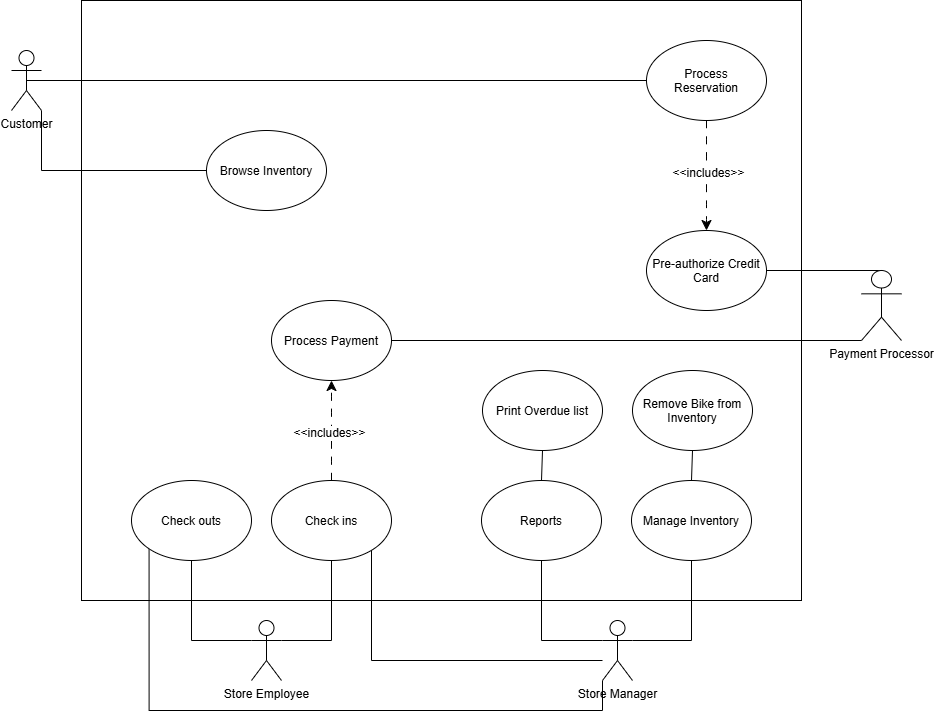

Joshua Samuel   
CS 361

# Section 1: Overview
The software system requested by the Bend Bike Shop will enable customers to rent and reserve bikes for a requested period of time. Employees will be able to confirm rentals, process returns, and manage the details of the store's inventory.

# Section 2: User Scenarios 
### My Scenarios
1. Tim is a regular visitor to Bend and often rents from the bike shop. He plans on renting a bike often enough that he will make an account for the store's website. Once logged in he selects the dates he wishes to rent on. From there he filters the bikes available to see only mountain bikes. He selects the bike he wants and proceeds to checkout. He inputs his card information, but avoids saving it to his account. You can never be too safe with your information online. Finally he selects place reservation and gets a screen confirming his reservation, with the additional note that he will also get an email confirming his appointment.

2. Anna is an assistant manager at the bike shop and has to print a number of daily reports each day. The report she currently needs has to do with bikes kept past their expected return time. She logs into the company's computer and makes her way to the reports screen. She selects the unreturned bike list and confirms the print. From there she can call the associated customer for the rental. One of the customers confessed they lost the bike and will pay for it. Going back to the computer Anna checks the bike in manually, adjusts the late fees to match the replacement cost and completes the transaction. She then must remove that bike from the inventory. She heads to the inventory management screen searches for the specific bike and removes it.

### Gemini's Scenarios
3. Marcus, a store employee at Bend Bike Shop, is working the counter when a tourist named Dave walks in, demanding a refund for a bike he returned two days late and visibly damaged. Marcus logs into the employee portal with his employee-level credentials. He pulls up Dave's active rental file, which automatically flags the late return fees and the technician's notes regarding a bent rim. Because regular employees do not have permission to issue refunds, Marcus's screen dims the refund button and prompts him to call a manager. He calls over Brenda, the store manager, who logs in with her higher-level credentials. Brenda reviews the notes, decides to grant a partial override credit for the late fee, and inputs the reason into the system ("customer goodwill gesture"). The system processes the adjustment through the payment processor, logs the manager's override in the audit trail, and generates a receipt for Dave.

4. Chloe, a stressed-out graphic designer who has not touched a bicycle since middle school, is visiting Bend for a relaxing weekend. She decides to use the kiosk/web interface as a "guest" without creating an account because she hates password fatigue. Arriving at the rental page, she sees options for mountain, road, and hybrid bikes. Confused, she selects "Hybrid" to see what is available for next Saturday. The system presents a clean grid of available hybrid bikes with sizing and pictures. She selects a bike, enters her contact info and payment details, and clicks "Place Reservation." The screen updates to a green confirmation page stating her card has been pre-authorized and her reservation is locked in, complete with a reminder that a store employee will handle the actual key handoff and helmet fitting when she arrives.

# Section 3: Non-Goals
The following are beyond the scope of the system and are not required for the solution.
* Automated discounts or dynamic pricing for available bikes
* No outright bike sales or automated charges of unreturned bikes. This will need an employee or manager.
* Rental extensions must also go through employees
* No automated handoffs or checkouts of bikes
* Don't worry about advertisements, that is for another team to worry about.

# Section 4: Use Case Diagram 

