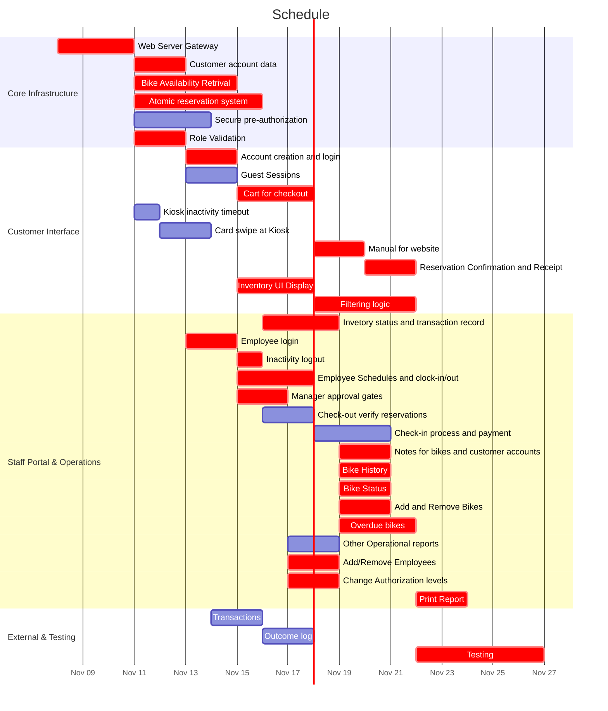

Joshua Samuel     
CS 361

# Estimation and Scheduling

## Estimation
I have a 90% certainty that the project can be done in 63 days (P90 estimate = 62.5 days).

### Work Breakdown Structure
* Bend Bike Shop Software System (100%)
    * Customer Website and Kiosk Interface (25%)
        * User Accounts/Guest Managment
            * Account creation and login
            * Guest Sessions
            * Cart for checkout
            * Kiosk inactivity timeout
        * Inventory Browsing and Filtering
            * Inventory UI Display
            * Filtering logic (including bikes on available dates)
        * Reservation Checkout
            * Card swipe at Kiosk
            * Manual for website
            * Reservation Confirmation and Receipt
    * Staff Portal (35%)
        * Employee login
        * Staff Dashboard UI
            * Inactivity logout
            * Employee Schedules and clock-in/out
        * Rental Check-in/out
            * Check-out verify reservations
            * Check-in process and payment
            * Notes for bikes and customer accounts
        * Manager Authorization Systems
            * Manager approval gates
            * Inventory Managment
                * Bike History
                * Bike Status
                * Add and Remove Bikes
            * Reports
                * Overdue bikes
                * Other Operational reports
                * Print Report
            * Staff account Creation and Managment 
                * Add/Remove Employees
                * Change Authorization levels
    * Backend (20%)
        * Web Server Gateway
        * Customer Reservation Service
            * Bike Availability Retrival
            * Atomic reservation system
        * Employee Authorization
            * Role Validation
        * Long-Term Database
            * Invetory status and transaction record
            * Customer account data
    * External Connections (10%)
        * Payment Processor connection
            * Secure pre-authorization 
            * Transactions
            * Outcome log
    * Testing (10%)

##  Scheduling

### CPM Table

| Task | Duration (days) | Dependencies | ES | EF | LS | LF | Slack |
| ------ | ----- | ------- | ------- | ------- | ------- | ------- | ------- |
| Web Server Gateway | 3.2 | - | 0 | 3.2 | 0 | 3.2 | 0 |
| Customer account data | 2.2 | Web Server Gateway | 3.2 | 5.4 | 3.2 | 5.4 | 0 |
| Kiosk inactivity timeout | 1.1 | Web Server Gateway | 3.2 | 4.3 | 9.5 | 10.6 | 6.3 |
| Bike Availability Retrival | 4.2 | Web Server Gateway | 3.2 | 7.4 | 3.2 | 7.4 | 0 |
| Atomic reservation system | 5.2 | Web Server Gateway | 3.2 | 8.4 | 3.2 | 8.4 | 0 |
| Secure pre-authorization | 3.3 | Web Server Gateway | 3.2 | 6.5 | 7.3 | 10.6 | 4.1 |
| Role Validation | 2 | Web Server Gateway | 3.2 | 5.2 | 3.2 | 5.2 | 0 |
| Account creation and login | 2.2 | Customer account data | 5.4 | 7.6 | 5.4 | 7.6 | 0 |
| Guest Sessions | 2 | Customer account data | 5.4 | 7.4 | 5.6 | 7.6 | 0.2 |
| Cart for checkout | 3 | Account creation and login, Guest Sessions | 7.6 | 10.6 | 7.6 | 10.6 | 0 |
| Card swipe at Kiosk | 2.2 | Kiosk inactivity timeout | 4.3 | 6.5 | 10.6 | 12.8 | 6.3 |
| Manual for website | 2.2 | Cart for checkout | 10.6 | 12.8 | 10.6 | 12.8 | 0 |
| Reservation Confirmation and Receipt | 2 | Card swipe at Kiosk, Manual for website | 12.8 | 14.8 | 12.8 | 14.8 | 0 |
| Inventory UI Display | 3.2 | Bike Availability Retrival | 7.4 | 10.6 | 7.4 | 10.6 | 0 |
| Filtering logic | 4.2 | Inventory UI Display | 10.6 | 14.8 | 10.6 | 14.8 | 0 |
| Invetory status and transaction record | 3.2 | Atomic reservation system | 8.4 | 11.6 | 8.4 | 11.6 | 0 |
| Employee login | 2 | Role Validation | 5.2 | 7.2 | 5.2 | 7.2 | 0 |
| Inactivity logout | 1.1 | Employee login | 7.2 | 8.3 | 7.2 | 8.3 | 0 |
| Employee Schedules and clock-in/out | 3.2 | Employee login | 7.2 | 10.4 | 7.2 | 10.4 | 0 |
| Manager approval gates | 2.2 | Employee login | 7.2 | 9.4 | 7.2 | 9.4 | 0 |
| Check-out verify reservations | 2.2 | Atomic reservation system, Employee login | 8.4 | 10.6 | 9.4 | 11.6 | 1 |
| Check-in process and payment | 3.2 | Check-out verify reservations | 10.6 | 13.8 | 11.6 | 14.8 | 1 |
| Notes for bikes and customer accounts | 2 | Invetory status and transaction record, Employee login | 11.6 | 13.6 | 11.6 | 13.6 | 0 |
| Bike History | 2.2 | Invetory status and transaction record, Manager approval gates | 11.6 | 13.8 | 11.6 | 13.8 | 0 |
| Bike Status | 2 | Invetory status and transaction record, Manager approval gates | 11.6 | 13.6 | 11.6 | 13.6 | 0 |
| Add and Remove Bikes | 2.2 | Invetory status and transaction record, Manager approval gates | 11.6 | 13.8 | 11.6 | 13.8 | 0 |
| Overdue bikes | 3.2 | Invetory status and transaction record, Manager approval gates | 11.6 | 14.8 | 11.6 | 14.8 | 0 |
| Other Operational reports | 2.2 | Manager approval gates | 9.4 | 11.6 | 12.6 | 14.8 | 3.2 |
| Add/Remove Employees | 2 | Manager approval gates | 9.4 | 11.4 | 9.4 | 11.4 | 0 |
| Change Authorization levels | 2.2 | Manager approval gates | 9.4 | 11.6 | 9.4 | 11.6 | 0 |
| Print Report | 2 | Overdue bikes, Other Operational reports | 14.8 | 16.8 | 14.8 | 16.8 | 0 |
| Transactions | 2.2 | Secure pre-authorization | 6.5 | 8.7 | 10.6 | 12.8 | 4.1 |
| Outcome log | 2 | Transactions | 8.7 | 10.7 | 12.8 | 14.8 | 4.1 |
| Testing | 5.2 | Reservation Confirmation and Receipt, Check-in process and payment, Outcome log | 14.8 | 20 | 14.8 | 20 | 0 |

### Gantt 

